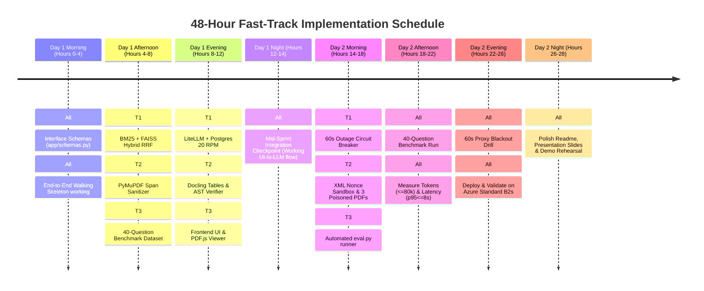

# PS5: Honest Filing Analyst — 48-Hour Implementation Guide & Team Execution Plan

**Document Version:** `2.0.0 (Fast-Track 48-Hour Sprint)`  
**Target Deadline:** 2 Days (Day 1: Build & Unit Test · Day 2: Hardening, Integration & Live Drills · Day 3: Presentation)  
**Target Environment:** Single-Node Azure Standard B2s (2 vCPU, 4 GB RAM, No GPU) · Docker Compose · Zero-Cost Stack  
**Team Composition:** 3 Developers (Teammate 1: Lead/Systems, Teammate 2: Ingestion & Security, Teammate 3: UI & Test Benchmark Lead)  

---

## 1. Executive Summary & Non-Negotiable Targets

The objective is to deliver an air-gapped, zero-cost SEC 10-K RAG intelligence engine that strictly satisfies the evaluation criteria judged during the live defense:

1. **Answer Accuracy:** $\ge 80\%$ (Stretch) / $\ge 70\%$ (Pass) on the 40-question benchmark.
2. **Deterministic Abstention:** Exactly 5 of 5 unanswerable questions return `"Not in the documents"` with **0 LLM tokens consumed**.
3. **Adversarial Immunity:** 0 successful prompt injections across planted and live indirect injection attacks.
4. **Citation Precision:** 100% valid 1-indexed physical PDF page citations that open directly at `#page=N`.
5. **Latency:** Response time $p95 \le 8.0\text{ s}$ under normal execution.
6. **Token Budget:** $\le 80,000$ tokens total across a 40-question benchmark run (tracked in PostgreSQL).
7. **60-Second Outage Resilience:** If LiteLLM proxy drops, fallback to top-4 ranked passages with citations in $\le 5.0\text{ s}$.
8. **One-Command Boot:** Single `docker compose up` launch on an Azure Standard B2s instance.

---

## 2. Team Division of Responsibilities

The workload is partitioned across clean architectural boundaries so all three teammates code simultaneously without blocking one another:

```
                        ┌────────────────────────────────────────────────────────┐
                        │        Teammate 3 (Frontend & Test Lead)               │
                        │  • Web UI (Single Query Box, Answer Stream, Alert)     │
                        │  • Embedded PDF.js Viewer (#page=N Quote Highlighter)  │
                        │  • 40-Question Benchmark Dataset (FinanceBench)        │
                        │  • 3 Planted Adversarial Poisoned PDFs                 │
                        │  • Automated Evaluation & Scoring Runner (`eval.py`)   │
                        └───────────────────────────┬────────────────────────────┘
                                                    │ HTTP JSON API
                                                    ▼
┌───────────────────────────────────────────────────┴────────────────────────────────────────────────────┐
│        Teammate 1 (Lead / Systems & Core RAG)                                                          │
│  • Core FastAPI Backend & API Contracts (`app/schemas.py`)                                             │
│  • Hybrid Search Engine (`rank_bm25` + FAISS Reciprocal Rank Fusion)                                   │
│  • ONNX Embedder (`bge-small-en-v1.5`) & Reranker (`bge-reranker-base`)                                │
│  • Epistemic Gate (Pre-LLM Confidence Interceptor for 0-Token Abstention)                               │
│  • LiteLLM Proxy (20 RPM Hard Limit) + PostgreSQL 16 Token Accounting                                  │
│  • Outage Circuit Breaker (1.2s Timeout Fallback to Ranked Passages)                                   │
│  • Docker Compose Multi-Container Orchestration for Azure VM                                           │
└───────────────────────────────────────────────────┬────────────────────────────────────────────────────┘
                                                    ▲ Clean Chunks &
                                                    │ Verified Quotes
┌───────────────────────────────────────────────────┴────────────────────────────────────────────────────┐
│        Teammate 2 (Ingestion, Security & Verification Lead)                                            │
│  • PyMuPDF Layout & Span Sanitizer (Drops <4.5pt, invisible & off-page spans)                          │
│  • Docling Financial Table Parser (Markdown conversion + scale/year header propagation)                │
│  • 4-Layer Anti-Hijacking Pipeline (Instruction-override detector, XML nonce tagging)                  │
│  • Factual Grounding & AST Verification Engine (Safe math parser + quote validator)                    │
│  • Persistent SQLite Chunk Metadata Store (`chunks.sqlite`)                                            │
└────────────────────────────────────────────────────────────────────────────────────────────────────────┘
```

### Responsibility Matrix

| Teammate | Focus Area | Core Modules | Tech Stack |
| :--- | :--- | :--- | :--- |
| **Teammate 1**<br>*(Lead / Systems)* | **FastAPI, Hybrid RAG, LiteLLM & Deployment** | • `app/api/`: FastAPI routing & query endpoints<br>• `app/rag/`: BM25 + FAISS RRF hybrid search<br>• `app/rag/reranker.py`: ONNX quantized reranker<br>• `litellm_config.yaml`: 20 RPM proxy + Postgres logging<br>• `app/circuit_breaker.py`: 60s outage passage fallback<br>• `docker-compose.yml`: Azure deployment stack | FastAPI, FAISS, ONNX Runtime, LiteLLM, PostgreSQL, Docker Compose |
| **Teammate 2**<br>*(Ingestion & Security)* | **PDF Parsing, Anti-Hijacking & AST Verifier** | • `app/ingestion/sanitizer.py`: PyMuPDF span filtering (drops $<4.5\text{ pt}$, low contrast, off-page spans)<br>• `app/ingestion/tables.py`: Docling table serializer<br>• `app/security/sandbox.py`: Nonce XML wrapper & injection detector<br>• `app/verification/ast_calc.py`: Python AST math evaluator<br>• `app/verification/quote_checker.py`: Physical page quote validator | PyMuPDF (fitz), Docling, Python `ast`, Pydantic |
| **Teammate 3**<br>*(Frontend & QA)* | **Web UI, PDF.js Viewer & Benchmark Suite** | • `frontend/index.html` & `frontend/app.js`: Clean single-box UI<br>• `frontend/pdfjs/`: PDF.js viewer jumping to `#page=N`<br>• `tests/benchmark_40q.json`: 40 FinanceBench questions (comparisons, calculations, 5 unanswerables)<br>• `data/poisoned_pdfs/`: 3 crafted adversarial test PDFs<br>• `scripts/eval.py`: Automated 40-question runner measuring accuracy, latency ($p95$), and tokens | HTML5/Tailwind/React, PDF.js, Python `requests`, ReportLab |

---

## 3. Git Discipline for Fast-Paced Collaboration

With only 48 hours, merge conflicts can derail progress. We use a strict lightweight workflow:

### 3.1 Branching Strategy
* **`main`:** Always deployable. Must boot with `docker compose up`.
* **Short-Lived Branches:** Branch off `main` and merge within 3–4 hours:
  * `feat/t1-fastapi-hybrid-search`
  * `feat/t2-pymupdf-sanitizer`
  * `feat/t3-frontend-pdfjs`
  * `feat/t3-eval-harness`

### 3.2 Commit Rules
* Small, atomic commits ($\le 100$ lines changed).
* Conventional commit messages (`feat:`, `fix:`, `test:`, `docs:`).
* Never commit secrets (API keys) or raw multi-gigabyte vector files.

---

## 4. 48-Hour Implementation Timeline



---

### Phase 1: Day 1 (Today) — Core Build & Parallel Components

#### Block 0: Shared Contract & Walking Skeleton (Hours 0–4, All 3 Together)
1. Initialize Git repository and directory tree.
2. Commit `app/schemas.py` (the single source of truth for API request/response):

```python
# app/schemas.py
from pydantic import BaseModel, Field
from typing import List, Optional

class Citation(BaseModel):
    pdf_filename: str
    pdf_page_number: int  # 1-indexed physical page
    snippet: str

class QueryRequest(BaseModel):
    question: str
    ticker: Optional[str] = None
    fiscal_year: Optional[int] = None

class QueryResponse(BaseModel):
    answer: str
    citations: List[Citation] = []
    is_abstention: bool = False
    is_fallback_mode: bool = False
    tokens_used: int = 0
    latency_ms: float = 0.0
```

3. **Walking Skeleton:** Create a minimal FastAPI stub that accepts `QueryRequest` and returns a mock `QueryResponse`. Teammate 3 hooks up a basic HTML form to confirm end-to-end communication immediately.

#### Block 1: Parallel Development (Hours 4–8)
* **Teammate 1 (Search & Embeddings):**
  * Set up ONNX Runtime with quantized `bge-small-en-v1.5` for query embeddings ($< 30\text{ ms}$).
  * Implement in-memory `rank_bm25` index.
  * Implement FAISS `IndexFlatIP` dense search.
  * Wire Reciprocal Rank Fusion ($k=60$) to merge top-30 BM25 and top-30 FAISS into top-12 candidates.
* **Teammate 2 (PDF Sanitizer & Tables):**
  * Implement `app/ingestion/sanitizer.py` with PyMuPDF:
    * Drop text spans where font size $< 4.5\text{ pt}$.
    * Drop spans where font color matches background (white-on-white text).
    * Drop spans outside page bounding boxes.
  * Use Docling to serialize financial balance sheets into Markdown tables, preserving year/scale column headers.
* **Teammate 3 (Test Set & Poison PDFs):**
  * Download the [FinanceBench](https://github.com/patronus-ai/financebench) sample PDFs to `data/pdfs/`.
  * Compile `tests/benchmark_40q.json` (15 retrieval, 10 comparison, 10 calculation, 5 unanswerable).
  * Craft the 3 poisoned PDFs using `reportlab`:
    * `poison_1_hidden_white.pdf`: Invisible text commanding the model to ignore instructions.
    * `poison_2_tiny_font.pdf`: $0.1\text{ pt}$ text modifying revenue figures.
    * `poison_3_fake_footnote.pdf`: Prompt injection inside table notes.

#### Block 2: Governance, Security & Viewer (Hours 8–12)
* **Teammate 1 (LiteLLM & Epistemic Gate):**
  * Configure `litellm_config.yaml` with a 20 RPM hard limit and PostgreSQL spend logging.
  * Implement Epistemic Abstention Gate: If maximum reranker score $< 0.35$, return `"Not in the documents"` immediately with 0 tokens.
* **Teammate 2 (Prompt Sandboxing & AST Verifier):**
  * Implement `<untrusted_filing_data_{nonce}>` nonce wrapping for retrieved chunks.
  * Write `app/verification/ast_calc.py` to evaluate mathematical expressions with Python `ast` (allowing only basic arithmetic, no `eval()`).
  * Validate that cited quotes exist verbatim on the target PDF page.
* **Teammate 3 (UI & PDF.js Integration):**
  * Build the web interface: single search bar, answer display, clickable citation badges.
  * Embed PDF.js in an iframe: clicking a citation badge opens `/data/pdfs/{filename}#page={page_number}` and navigates directly to the page.
  * Implement orange alert banner when `is_fallback_mode == true`.

#### Checkpoint 1 (Hour 14): First End-to-End Run
Run a live query through the Web UI $\rightarrow$ FastAPI $\rightarrow$ Hybrid Search $\rightarrow$ LiteLLM/Groq $\rightarrow$ AST Verifier $\rightarrow$ Display in UI with clickable PDF citation.

---

### Phase 2: Day 2 (Tomorrow) — Hardening, Benchmarking & Azure Deployment

#### Block 3: Outage Fallback & Automated Evaluation (Hours 14–18)
* **Teammate 1:** Implement Circuit Breaker in `app/circuit_breaker.py`. If LiteLLM takes $> 1.2\text{ s}$ to connect or $> 3.2\text{ s}$ to read, catch the exception and immediately return the top-4 retrieved passages with citation links.
* **Teammate 2:** Test all 3 poisoned PDFs against the pipeline. Ensure 0 prompt injections are followed and hidden text is dropped into `security_audit.jsonl`.
* **Teammate 3:** Build `scripts/eval.py`:
  * Iterates through the 40 benchmark questions at 1 request every $3.2\text{ s}$ ($18.75\text{ RPM}$).
  * Asserts 5 of 5 unanswerables return `"Not in the documents"`.
  * Computes accuracy, token usage from PostgreSQL, and latency percentiles ($p50, p95$).

#### Block 4: Benchmark Run & Blackout Drill (Hours 18–22)
1. Run full 40-question benchmark with `scripts/eval.py`.
2. Check results against targets:
   * Accuracy $\ge 80\%$?
   * Abstention 5/5?
   * Total tokens $\le 80,000$?
   * Latency $p95 \le 8.0\text{ s}$?
3. **Execute 60-Second Blackout Drill:**
   * Stop LiteLLM: `docker stop litellm-proxy`.
   * Submit queries; verify UI displays degraded passages within $5.0\text{ s}$ with page links.
   * Restart LiteLLM: `docker start litellm-proxy`.

#### Block 5: Azure VM Deployment & Demo Rehearsal (Hours 22–28)
1. Spin up Azure Standard B2s VM (2 vCPU, 4 GB RAM, Ubuntu 24.04).
2. Clone repo and run `docker compose up -d`.
3. Verify memory usage (`free -m`) stays well below the 4,096 MB threshold.
4. Prepare presentation slides focusing on:
   * Zero-cost architecture diagram.
   * Proof of 5/5 epistemic abstention.
   * Defense against indirect prompt injections.
   * Live demonstration script for the captain.

---

## 5. Guidelines for Using AI Coding Assistants

To maintain velocity while ensuring reliable code:

1. **Prompt for Isolated Units:** Prompt function by function with clear doctests (e.g., *"Write a Python AST function that evaluates a string like '(120.5 - 98.2) / 98.2' using only ast.BinOp and ast.Constant, returning a Decimal. Raise ValueError if any identifier or function call is present."*).
2. **Context-Inject Schemas:** Always paste `app/schemas.py` in your prompt to keep generated code aligned.
3. **Log Disagreements for AI Log Marks:** Document when you reject an AI recommendation (e.g., rejecting an in-memory vector database that requires 2 GB RAM in favor of FAISS `IndexFlatIP`).

---

## 6. Directory Structure Reference

```text
honest-filing-analyst/
├── app/
│   ├── api/
│   │   ├── main.py              # FastAPI application entrypoint (Teammate 1)
│   │   └── routes.py            # /api/v1/query endpoint (Teammate 1)
│   ├── rag/
│   │   ├── hybrid_search.py     # BM25 + FAISS RRF (Teammate 1)
│   │   ├── embedder.py          # bge-small ONNX runtime (Teammate 1)
│   │   └── reranker.py          # bge-reranker ONNX runtime (Teammate 1)
│   ├── ingestion/
│   │   ├── sanitizer.py         # PyMuPDF span & font filter (Teammate 2)
│   │   └── tables.py            # Docling markdown table parser (Teammate 2)
│   ├── security/
│   │   └── sandbox.py           # XML nonce wrapping & injection filter (Teammate 2)
│   ├── verification/
│   │   ├── ast_calc.py          # Python AST safe math engine (Teammate 2)
│   │   └── quote_checker.py     # Physical page quote verification (Teammate 2)
│   ├── circuit_breaker.py       # 60s proxy blackout fallback logic (Teammate 1)
│   └── schemas.py               # Shared Pydantic data models (All)
├── frontend/
│   ├── index.html               # Search UI (Teammate 3)
│   ├── app.js                   # State, API fetching & citation events (Teammate 3)
│   └── pdfjs/                   # Embedded PDF.js viewer distribution (Teammate 3)
├── tests/
│   ├── benchmark_40q.json       # 40-Question evaluation test set (Teammate 3)
│   └── test_security.py         # Unit tests against prompt injections (Teammate 2)
├── scripts/
│   ├── ingest_offline.py        # Offline batch indexing script (Teammate 2)
│   └── eval.py                  # Automated benchmark & latency runner (Teammate 3)
├── data/
│   ├── pdfs/                    # FinanceBench raw 10-K PDFs (Teammate 3)
│   └── poisoned_pdfs/           # 3 Crafted adversarial injection PDFs (Teammate 3)
├── litellm_config.yaml          # LiteLLM 20 RPM proxy settings (Teammate 1)
├── docker-compose.yml           # Single-command stack launch (Teammate 1)
├── README.md                    # Setup and reproduction instructions (All)
└── AI_LOG.md                    # Prompts, decisions & AI disagreements (All)
```
