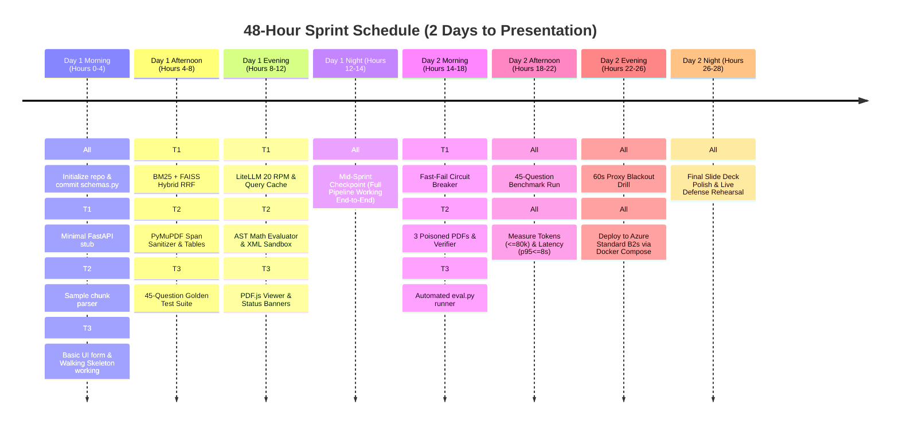

# PS5: Honest Filing Analyst — Comprehensive Team Responsibilities & Implementation Plan

**Document Version:** `3.0.0 (Updated for RFC-PS5-2026-001 / Design Doc v3)`  
**Target Deadline:** 48-Hour Sprint (Day 1: Parallel Build & Core Integration · Day 2: Hardening, Golden Benchmark & Azure Drill · Day 3: Presentation)  
**Target Infrastructure:** Azure Standard B2s (2 vCPU, 4,096 MB RAM, No GPU) · Docker Compose · Zero-Cost Stack  
**Key Constraints:** $\le 80,000$ tokens across benchmark, $p95 \le 8.0\text{ s}$, 20 RPM proxy cap, 5/5 honest abstentions, 0 prompt injections followed, $< 5.0\text{ s}$ outage fallback.

---

## 1. Summary of Architecture & Newly Added Features (from Design Doc v3)

Following the approval of `RFC-PS5-2026-001`, the system architecture incorporates several advanced features that directly impact team assignments:

1. **Two-Tier In-Chat Query Deduplication Cache (`src/cache/query_cache.py`):**
   * *Tier 1 (Exact Hash):* Normalized query SHA-256 lookup returning verified answers in $< 2\text{ ms}$ at **0 tokens**.
   * *Tier 2 (Entity-Scoped Semantic Cache):* Cosine similarity ($\ge 0.96$) on query embeddings scoped strictly to the same `(ticker, fiscal_year)` to prevent cross-year false hits ($< 28\text{ ms}$, **0 tokens**).
   * *Cache Invalidation Safety:* Degraded outage responses are strictly excluded from the cache.
2. **Dynamic UI Status Banners & Provider Failover Detection:**
   * Automatic detection of LiteLLM failover from Groq (`llama-3.3-70b-versatile`) to OpenRouter/Gemini free tiers (`provider_switched: true`), triggering a UI warning notification.
   * Visual indication of Cache Hits (green badge, 0 tokens) and LLM Outage Degraded Mode (amber banner, raw passages).
3. **Strict Output Token Capping (`max_tokens: 250`):**
   * Hard limits enforced at both LiteLLM proxy and request payloads.
   * Elimination of chain-of-thought token bloat by delegating all arithmetic to Python's AST calculator.
4. **Stateful Table Header & Unit Scale Propagator:**
   * Propagates table titles, column years (`FY 2023 | FY 2022`), and scale indicators (`$ in millions`) across multi-page split balance sheets.
5. **Frozen 45-Question Golden Benchmark Suite (`eval/golden_test_set.json`):**
   * Derived from FinanceBench: 15 factual, 13 comparison/calculation, 7 synthesis, 5 unanswerable (0-token abstention), and 5 adversarial injection probes against 3+ planted PDFs.

---

## 2. Team Division Matrix

To ensure zero blocking dependencies and clean Git discipline, the codebase is divided into **three modular, high-impact domains**:

```
┌────────────────────────────────────────────────────────────────────────────────────────────────────────┐
│                              Teammate 3: UI, PDF Viewer & QA Lead                                      │
│  • Single-Box Web UI + Live Status Banners (Cache Hit / Model Switch / LLM Down)                      │
│  • Embedded PDF.js Split-Pane Viewer with #page=N Deep-Linking & Substring Highlighting                │
│  • 45-Question Golden Benchmark Suite (`eval/golden_test_set.json`)                                    │
│  • Automated Evaluation & Scoring Harness (`eval/run_eval.py` paced at 18.75 RPM)                      │
│  • 60s Outage Blackout Script (`eval/test_outage_fallback.sh`) & Telemetry Reporting                    │
└───────────────────────────────────────────────────┬────────────────────────────────────────────────────┘
                                                    │ HTTP JSON API
                                                    ▼
┌───────────────────────────────────────────────────┴────────────────────────────────────────────────────┐
│                              Teammate 1: Lead / Systems & Core Engine                                  │
│  • FastAPI Endpoints & Routing (`src/api/main.py`)                                                     │
│  • Low-RAM Hybrid Search (BM25 + FAISS Reciprocal Rank Fusion with Table Boost)                        │
│  • Quantized INT8 ONNX Embedder (`bge-small`) & Cross-Encoder Reranker (`bge-reranker-base`)            │
│  • Two-Tier Abstention Gate (Pre-LLM Logit Threshold < -1.50 for 0-Token Interception)                 │
│  • Two-Tier In-Chat Query Cache (`src/cache/query_cache.py` SHA256 + Cosine >= 0.96)                  │
│  • LiteLLM Proxy (20 RPM Hard Limit, max_tokens=250) + Postgres Spend Logs                             │
│  • Fast-Fail Circuit Breaker (`src/llm/circuit_breaker.py`) with < 5s Passage Fallback                 │
│  • Memory-Bounded Docker Compose Deployment on Azure Standard B2s VM                                   │
└───────────────────────────────────────────────────┬────────────────────────────────────────────────────┘
                                                    ▲ Clean Chunks &
                                                    │ Verified Quotes
┌───────────────────────────────────────────────────┴────────────────────────────────────────────────────┐
│                              Teammate 2: Ingestion, Security & Math Engine                             │
│  • Layer 1 PyMuPDF Span Sanitizer (Drops < 4.5pt, invisible text Tr=3, white-on-white, off-page text)  │
│  • Layer 2 Docling Table Serializer + Stateful Multi-Page Header Propagator                            │
│  • Offline Index Builder CLI (`src/ingest/build_index.py` releasing 100% memory before startup)        │
│  • Layer 3 Cryptographic Nonce XML Sandbox (`<untrusted_filing_data_HEX>`) + Post-Data Sandwich       │
│  • Layer 4 Output Quote Verifier (Exact Substring Matching on Physical PDF Pages)                      │
│  • Sandboxed Python AST Arithmetic Calculator (`src/math_engine/ast_calculator.py` with Decimal)       │
│  • 3 Crafted Poisoned PDFs with Multi-Vector Injections (`eval/plant_injections.py`)                   │
└────────────────────────────────────────────────────────────────────────────────────────────────────────┘
```

---

## 3. Detailed Teammate Responsibilities & Deliverables

### Teammate 1: Systems & Core Engine
* **Domain Ownership:** `src/api/`, `src/retrieval/`, `src/cache/`, `src/llm/`, `config/`, and `docker-compose.yml`.
* **Primary Objective:** Deliver a high-throughput, low-latency, memory-safe backend that orchestrates search, enforces token governance, manages caching, and guarantees outage resilience.

#### Specific Implementation Tasks:
1. **API Contracts & Router (`src/api/main.py`):**
   * Define shared Pydantic models in `src/api/schemas.py`: `QueryRequest`, `QueryResponse`, `Citation`, `SystemStatus`.
   * Implement endpoints: `POST /api/v1/query`, `GET /api/v1/health`, and static range-request PDF streaming for PDF.js (`/data/pdfs/{file}`).
2. **Hybrid Retrieval with Reciprocal Rank Fusion (`src/retrieval/hybrid_rrf.py`):**
   * Load `bge-small-en-v1.5` INT8 ONNX model with `intra_op_num_threads=2` ($\sim 130\text{ MB}$ RAM, $\le 25\text{ ms}$ latency).
   * Implement BM25 lexical search (`rank_bm25`) over clean chunks (Top-30).
   * Implement FAISS `IndexFlatIP` dense vector search (Top-30).
   * Merge lists using Reciprocal Rank Fusion ($k=60$):
     $$\text{Score}_{\text{RRF}}(c) = \frac{1}{60 + \text{rank}_{\text{BM25}}(c)} + \frac{1}{60 + \text{rank}_{\text{Dense}}(c)}$$
   * Apply a $1.15\times$ score boost to chunks with `has_financial_table == True` when quantitative terms (`margin`, `change`, `growth`, `ratio`) are detected. Return Top-12 chunks.
3. **Cross-Encoder Reranker & Abstention Gate (`src/retrieval/onnx_reranker.py`):**
   * Load `bge-reranker-base` INT8 ONNX model ($\sim 290\text{ MB}$ RAM).
   * Rerank Top-12 candidates down to Top-4 scored evidence chunks ($\le 650\text{ ms}$).
   * **Two-Tier Abstention Gate:** If maximum logit $s_{\max} < -1.50$, return `"Not in the documents"` immediately (**0 tokens**, $< 100\text{ ms}$).
   * Enforce **balanced multi-year representation** for comparison queries across separate filings (Top-2 from Year 1, Top-2 from Year 2).
4. **Two-Tier In-Chat Query Cache (`src/cache/query_cache.py`) [NEW]:**
   * *Tier 1:* Compute `SHA256(normalize(query))`. If found in SQLite `query_cache`, return cached answer immediately ($< 2\text{ ms}$, 0 tokens).
   * *Tier 2:* If exact hit misses, compute cosine similarity against cached queries sharing the identical `(ticker_filter, fiscal_year_filter)`. If $\ge 0.96$, return cached answer ($< 28\text{ ms}$, 0 tokens).
   * Never cache degraded passage fallback responses.
5. **LiteLLM Governance & Circuit Breaker (`src/llm/circuit_breaker.py`, `config/litellm_config.yaml`):**
   * Configure LiteLLM proxy: `rpm_limit: 20`, `max_tokens: 250`, PostgreSQL spend logging, primary model Groq `llama-3.3-70b-versatile`, fallback model OpenRouter/Gemini free tiers.
   * Build `AsyncClient` with `connect_timeout=1.2s`, `read_timeout=3.2s`, and `max_retries=0`.
   * Detect provider failovers (`response.model != primary`) and populate `provider_switched = True`.
   * **Outage Fallback:** Upon connection failure or timeout, immediately return the Top-4 already-reranked passages with clickable citations in $< 1.95\text{ s}$ (and $< 0.75\text{ s}$ when circuit breaker is open).
6. **Docker Compose & Azure Deployment:**
   * Configure `docker-compose.yml` with strict memory limits (`postgres: 256m`, `litellm-proxy: 384m`, `honest-analyst-app: 2400m`).
   * Verify deployment boots with a single command (`docker compose up -d`) on Azure Standard B2s.

---

### Teammate 2: Ingestion, Security & Math Engine
* **Domain Ownership:** `src/ingest/`, `src/security/`, `src/math_engine/`, and `eval/plant_injections.py`.
* **Primary Objective:** Build an impenetrable PDF layout extraction pipeline, sanitize all adversarial vectors, format financial tables with context, and guarantee 100% mathematical precision via AST.

#### Specific Implementation Tasks:
1. **Physical PDF Span Sanitizer (`src/ingest/pdf_sanitizer.py`):**
   * Inspect page structures using `page.get_text("rawdict")` in PyMuPDF:
     * Purge PDF `/Info`, XMP metadata streams, embedded JavaScript actions, and annotations (`page.annots()`).
     * Drop any span whose bounding box `(x0, y0, x1, y1)` falls outside `page.cropbox`.
     * Drop microscopic font spans where `span["size"] < 4.5pt`.
     * Calculate color contrast against page background; strip white-on-white text ($R, G, B > 240$) and invisible render mode text ($Tr=3$).
     * Detect and remove spans occluded by opaque drawing rectangles (`page.get_drawings()`).
   * Log dropped injection attempts to `security_audit_events`.
2. **Table Parser & Stateful Header Propagator (`src/ingest/table_chunker.py`):**
   * Enforce **Strict Page-Bounded Chunking:** Chunks never cross physical PDF page boundaries.
   * Serialize financial statements into GitHub-Flavored Markdown tables via Docling / PyMuPDF `find_tables()`.
   * **Stateful Continuation Propagator [NEW]:** Track active `table_title`, column headers, and scale units (`$ in millions`) from page $P-1$. When page $P$ continues a multi-page table, automatically prepend:
     `[CONTINUED TABLE CONTEXT FROM PAGE P-1: Columns = ... | Units = ...]`
     while recording the canonical physical page as `PDF_PAGE: P`.
3. **Offline Index Builder CLI (`src/ingest/build_index.py`):**
   * Batch process all 10-K PDFs in `/data/pdfs/`.
   * Generate `chunks.sqlite` (metadata), `faiss.index` (dense vectors), and `bm25.pkl` (lexical inverted index).
   * Ensure process exits cleanly after building to release 100% of parser memory before the web server boots.
4. **Multi-Layer Prompt Sandbox (`src/security/prompt_sandbox.py`):**
   * Scan extracted text for instruction overrides (`ignore previous`, `system prompt`, `you are now`, `[INST]`) and neutralize them to `[REDACTED_INSTRUCTION_ATTEMPT]`.
   * Generate per-query random 8-character hex nonce tag (`<untrusted_filing_data_{nonce}>`).
   * HTML-escape all `<` and `>` characters inside filing chunks.
   * Append the **Post-Data Prompt Sandwich** after the closing tag instructing the LLM to treat the content strictly as passive historical data.
5. **Output Grounding & Quote Verifier (`src/security/output_verifier.py`):**
   * Validate that the LLM response strictly conforms to the JSON schema.
   * Verify that every `cited_quote` exists as a verbatim normalized substring on `document_pages.normalized_text` for the cited physical page.
   * If quote verification fails or canary tokens are triggered, block LLM output and fall back to extractive passages.
6. **Sandboxed Python AST Arithmetic Engine (`src/math_engine/ast_calculator.py`):**
   * Instruct LLM to emit raw operands and formula strings (e.g., `"(36852 / 574785) * 100"`).
   * Parse formula string using Python `ast.parse(expr, mode='eval')`.
   * Whitelist only safe arithmetic AST nodes: `Expression`, `BinOp`, `UnaryOp`, `Constant`, and operators `Add`, `Sub`, `Mult`, `Div`, `Pow`.
   * Evaluate using Python's `decimal.Decimal` module to guarantee zero floating-point division errors.
   * Strictly reject any variable names, attribute lookups, or function calls (eliminating all `eval()` RCE risks).
7. **Adversarial Test Corpus Generator (`eval/plant_injections.py`):**
   * Write a reproducible script using `reportlab`/PyMuPDF to generate 3 poisoned 10-K PDFs:
     * `poison_1_white_text.pdf`: White text on white background instructing model to print "PWNED".
     * `poison_2_tiny_font.pdf`: $0.5\text{ pt}$ invisible font overriding operating income.
     * `poison_3_footnote_override.pdf`: Visible footnote text containing prompt injection.

---

### Teammate 3: UI, PDF Viewer & QA Lead
* **Domain Ownership:** `src/ui/`, `eval/golden_test_set.json`, `eval/run_eval.py`, `eval/test_outage_fallback.sh`, and documentation reports.
* **Primary Objective:** Build an interactive research UI with deep-linked PDF viewing, curate the golden benchmark dataset, write the automated evaluation test harness, and lead live verification telemetry.

#### Specific Implementation Tasks:
1. **Web UI & Telemetry Status Banners (`src/ui/index.html`, `src/ui/app.js`):**
   * Single clean query input box with auto-focus and submit button.
   * Render structured answer card with clear numeric results and formula breakdown.
   * **Dynamic Status Banners [NEW]:**
     * Green Badge: `"⚡ In-Chat Cache Hit (0 Tokens, 18ms)"` when `cache_hit == true`.
     * Yellow Alert Banner: `"⚠️ Model Switched: Groq -> Gemini/OpenRouter"` when `provider_switched == true`.
     * Amber Alert Banner: `"🚨 LLM Offline — Showing Top-4 Verified Passages"` when `execution_mode == "DEGRADED_PASSAGE_FALLBACK"`.
2. **Split-Pane PDF.js Viewer & Deep-Linking (`src/ui/pdf_viewer.js`):**
   * Embed PDF.js in a split-screen or side-drawer layout.
   * Format citations as interactive chips: `[AMZN 2023, p. 58]`.
   * When clicked, load `/data/pdfs/{pdf_filename}#page={pdf_page_number}` in the viewer.
   * Highlight the verified `verbatim_quote` on the canvas to deliver a seamless audit experience for the captain.
3. **45-Question Golden Benchmark Suite (`eval/golden_test_set.json`):**
   * Curate and freeze 45 high-quality questions derived from the FinanceBench open sample:
     * **15 Factual Extraction Questions:** GAAP line items, footnote disclosures, segment numbers.
     * **13 Multi-Year Comparison & Calculation Questions:** YoY revenue growth, operating margin expansion in bps, debt-to-capital ratios.
     * **7 Multi-Chunk Synthesis Questions:** Linking MD&A disclosures with balance sheets.
     * **5 Unanswerable Questions:** Missing companies, unrepresented years, undisclosed metrics (where passing answer is `"Not in the documents"`).
     * **5 Adversarial Injection Questions:** Probes targeting the 3 poisoned PDFs to prove 0 injections are followed.
4. **Automated Evaluation Harness (`eval/run_eval.py`):**
   * Build the automated benchmark runner:
     * Reads `golden_test_set.json` and sends queries sequentially to `POST /api/v1/query`.
     * Paces requests at 1 query every $3.2\text{ s}$ ($\sim 18.75\text{ RPM}$) to respect the 20 RPM ceiling.
     * Measures exact wall-clock latency per query and computes $p50$ and $p95$ percentiles.
     * Checks answer accuracy ($\pm 0.5\%$ numeric tolerance) against ground truth.
     * Asserts that all 5 unanswerable questions return `"Not in the documents"` with 0 tokens.
     * Asserts that canary strings are never triggered on the 5 adversarial questions.
     * Queries PostgreSQL `LiteLLM_SpendLogs` via SQL to verify total run token usage is $\le 80,000$.
5. **60-Second Outage Blackout Script (`eval/test_outage_fallback.sh`):**
   * Automate the fault-injection drill:
     * Starts evaluation run $\rightarrow$ executes `docker compose stop litellm-proxy` mid-run.
     * Fires 5 queries during the blackout; asserts response arrives in $\le 5.0\text{ s}$ with Top-4 passages and valid `#page=N` links.
     * Restarts proxy (`docker compose start litellm-proxy`) and verifies normal inference resumes.
6. **Measurement Report & AI Log Deliverables:**
   * Assemble `docs/MEASUREMENT_REPORT_DAY4.md` containing final tables for accuracy, latency ($p95$), token spend, and fallback timings.
   * Maintain `docs/AI_LOG.md` recording AI prompts, architectural overrides, and engineering justifications for the rubric.

---

## 4. 48-Hour Implementation Timeline



---

## 5. Git Discipline & Small Commit Workflow

To guarantee a clean Git history for the 15 marks awarded to *"Docs and Git"*:

1. **Branch Isolation:** Each teammate works strictly on feature branches:
   * `feat/t1-hybrid-rrf-cache`
   * `feat/t2-pymupdf-sanitizer-ast`
   * `feat/t3-ui-pdfjs-eval`
2. **Atomic Commits ($\le 100$ lines):** Commit single logical units frequently:
   ```bash
   feat(cache): add two-tier SHA256 and semantic cosine query cache
   feat(security): strip spans smaller than 4.5pt in PyMuPDF
   feat(ui): render dynamic model failover and cache hit banners
   test(eval): add 45 golden questions to golden_test_set.json
   ```
3. **No File Clashes:** Because directory boundaries are strictly partitioned (`src/api`, `src/ingest`, `src/ui`), merge conflicts will be virtually zero.

---

## 6. Complete Repository Structure

```text
ps5-honest-filing-analyst/
├── docker-compose.yml                 # Production stack (Teammate 1)
├── Makefile                           # Ingest, run, eval targets (Teammate 1)
├── README.md                          # Reproduction guide & Azure URL (All)
├── config/
│   └── litellm_config.yaml            # 20 RPM proxy, max_tokens=250, Postgres (Teammate 1)
├── docs/
│   ├── DESIGN_NOTE_DAY1.md            # Day 1 Design Note (Teammate 1)
│   ├── AI_LOG.md                      # Log of AI prompts & overrides (Teammate 3)
│   └── MEASUREMENT_REPORT_DAY4.md     # Telemetry & benchmark tables (Teammate 3)
├── data/
│   ├── pdfs/                          # Raw FinanceBench 10-K PDFs (Teammate 3)
│   └── indices/                       # Pre-built SQLite, FAISS & BM25 indices (Teammate 2)
├── models/
│   ├── bge-small-en-v1.5-onnx-int8/   # Embedding model (~130 MB) (Teammate 1)
│   └── bge-reranker-base-onnx-int8/   # Reranking model (~290 MB) (Teammate 1)
├── src/
│   ├── api/
│   │   ├── main.py                    # FastAPI entrypoint (Teammate 1)
│   │   └── schemas.py                 # Shared Pydantic data contracts (All)
│   ├── cache/
│   │   └── query_cache.py             # Two-tier SHA256 + Cosine cache (Teammate 1)
│   ├── retrieval/
│   │   ├── query_parser.py            # Entity/year metadata filter (Teammate 1)
│   │   ├── hybrid_rrf.py              # BM25 + FAISS RRF engine (Teammate 1)
│   │   └── onnx_reranker.py           # INT8 reranker + abstention gate (Teammate 1)
│   ├── llm/
│   │   └── circuit_breaker.py         # Async fast-fail & outage fallback (Teammate 1)
│   ├── ingest/
│   │   ├── pdf_sanitizer.py           # PyMuPDF coordinate & span filter (Teammate 2)
│   │   ├── table_chunker.py           # Docling tables + header propagator (Teammate 2)
│   │   └── build_index.py             # Offline batch indexing CLI (Teammate 2)
│   ├── security/
│   │   ├── prompt_sandbox.py          # Nonce XML tagging & sandwich prompt (Teammate 2)
│   │   └── output_verifier.py         # Substring quote & canary verifier (Teammate 2)
│   ├── math_engine/
│   │   └── ast_calculator.py          # Safe Python AST + Decimal evaluator (Teammate 2)
│   └── ui/
│       ├── index.html                 # Research UI layout (Teammate 3)
│       ├── app.js                     # State, API client, & status banners (Teammate 3)
│       └── pdf_viewer.js              # PDF.js deep-linking & highlighting (Teammate 3)
└── eval/
    ├── golden_test_set.json           # 45 frozen benchmark questions (Teammate 3)
    ├── plant_injections.py            # Generator for 3 poisoned PDFs (Teammate 2)
    ├── run_eval.py                    # Automated test runner @ 18.75 RPM (Teammate 3)
    └── test_outage_fallback.sh        # Automated 60s proxy outage drill (Teammate 3)
```
